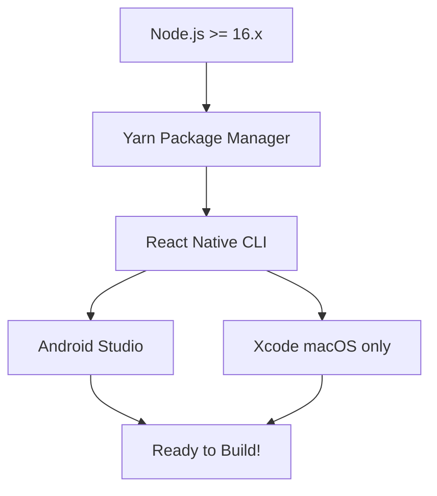
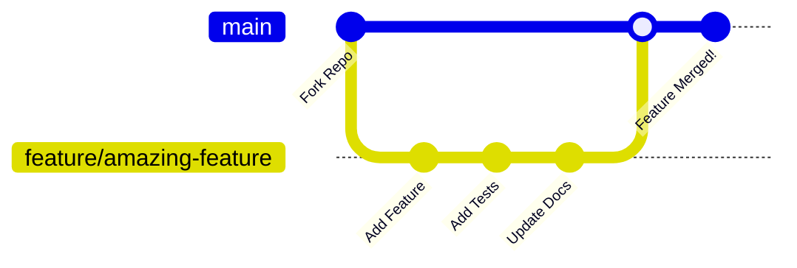
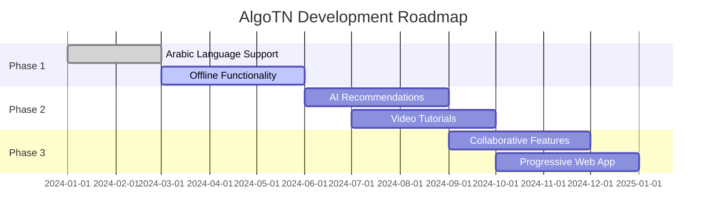

# AlgorithmeTN

[](https://reactnative.dev/)
[](https://www.typescriptlang.org/)
[](https://firebase.google.com/)
[](https://m3.material.io/)

> [!CAUTION]
> **PROJECT STATUS: DISCONTINUED** 
> 
> This project is currently discontinued because it didn't go as I planned. If I see any contributions, I will get back to work on the project.

**A comprehensive educational platform for Tunisian Baccalaureate students to master algorithms and programming concepts**

---

## 🌟 About

> [!NOTE]
> **AlgoTN** is a modern React Native application specifically designed for Tunisian high school students preparing for their Baccalaureate exams.

The app provides an interactive platform to learn, practice, and share algorithms across different educational tracks:

- 🧪 **Sciences Naturelles** (Natural Sciences)
- 💻 **Sciences Informatiques** (Computer Science) 
- 📊 **Économie & Gestion** (Economics & Management)

### 🎯 Mission
> To democratize algorithm education in Tunisia by providing accessible, interactive, and culturally relevant learning materials in multiple languages.

## ✨ Features

### 📚 Educational Platform
```yaml
Grade Levels: [1ère, 2ème, 3ème, BAC]
Tracks: [Sciences Naturelles, Sciences Informatiques, Économie & Gestion]
Content: Interactive algorithms with step-by-step explanations
Progress: Bookmark system and achievement tracking
```

### 💻 Advanced Code Editor
```yaml
Languages: [JavaScript, Python, Java, C++, PHP, SQL, Custom "algo" pseudocode]
Features: [Syntax highlighting, Real-time editing, Copy/paste, Undo/redo]
Integration: Seamless WebView integration with native app
```

### 🌐 Social & Sharing
```yaml
Community: [Comments system, Like/bookmark functionality]
Profiles: [User statistics, Achievements, Activity feeds]
Notifications: Real-time updates and notifications
```

### 🎨 Modern UX/UI
```yaml
Design: Material Design 3 with React Native Paper
Themes: [Dark mode, Light mode, System integration]
Animation: Smooth transitions with Reanimated 3
Responsive: Adaptive design for all screen sizes
```


## 🚀 Installation

> [!IMPORTANT]
> **Prerequisites:** Ensure you have the following installed before proceeding



### ⚡ Quick Start

> [!TIP]
> Follow these steps to get the project running locally

```bash
# 1. Clone the repository
git clone https://github.com/yourusername/AlgorithmeTN.git
cd AlgorithmeTN

# 2. Install dependencies
yarn install

# 3. Install iOS dependencies (macOS only)
cd ios && pod install && cd ..

# 4. Start Metro bundler
yarn start

# 5. Run on your platform
yarn android  # For Android
yarn ios      # For iOS (macOS only)
```

### 🔧 Environment Setup

> [!WARNING]
> **Required Configuration:** These steps are mandatory for the app to function properly

#### Firebase Configuration
```bash
# Add your Firebase config files to:
# 📁 android/app/google-services.json
# 📁 ios/AlgoTN/GoogleService-Info.plist
```

#### OneSignal Setup
```bash
# Configure OneSignal App ID in your environment variables
ONESIGNAL_APP_ID=your_app_id_here
```

#### Appodeal Integration
```bash
# Set up Appodeal keys for monetization
APPODEAL_API_KEY=your_api_key_here
```

## 🏗️ Project Structure

```
AlgorithmeTN/
├── 📁 src/
│   ├── 📁 components/           # Reusable UI components
│   │   ├── 📁 baseview/        # Base layout component
│   │   ├── 📁 code-editor-webview/  # Custom code editor with algo syntax
│   │   ├── 📁 modals/          # Modal components (image picker, etc.)
│   │   ├── 📁 numbered-list/   # Instruction list component
│   │   └── 📁 spacer/          # Layout spacing utilities
│   ├── 📁 config/              # Configuration files
│   │   ├── 📁 i18n/           # Internationalization (FR/EN/AR)
│   │   ├── 📁 navigation/     # Navigation setup & deep linking
│   │   ├── 📁 storage/        # MMKV storage configuration
│   │   └── 📄 dimensions.ts    # Responsive design helpers
│   ├── 📁 screens/             # Application screens
│   │   ├── 📁 algo/           # Algorithm viewing & editing
│   │   ├── 📁 home/           # Main app screens
│   │   ├── 📁 login/          # Authentication flow
│   │   └── 📁 settings/       # User settings & preferences
│   ├── 📁 types/              # TypeScript type definitions
│   └── 📁 utils/              # Helper functions & utilities
├── 📁 android/                # Android-specific code
├── 📁 ios/                    # iOS-specific code
└── 📄 package.json           # Dependencies & scripts
```

## 🤝 Contributing

> [!NOTE]
> **We welcome contributions!** This project needs community support to continue development.

### 🐛 How to Contribute



#### Step-by-step guide:

1. **🍴 Fork** the repository
2. **🌿 Create** a feature branch: `git checkout -b feature/amazing-feature`
3. **📝 Follow** TypeScript and React Native best practices
4. **🧪 Test** your changes thoroughly
5. **💾 Commit** with clear messages: `git commit -m 'Add amazing feature'`
6. **🚀 Push** to your branch: `git push origin feature/amazing-feature`
7. **📬 Submit** a pull request

> [!TIP]
> **Code Style:** Follow the existing patterns in the codebase and use TypeScript strictly

## 🔮 Future Roadmap

> [!NOTE]
> **If development resumes**, these features are planned for future releases



### Planned Features:

- [ ] 🌍 **Arabic language support** with full RTL layout
- [ ] 📱 **Offline functionality** for algorithm access without internet  
- [ ] 🎮 **Gamification system** with points and achievements
- [ ] 🤖 **AI-powered recommendations** for personalized learning
- [ ] 🎥 **Video tutorials** integration for visual learners
- [ ] 👥 **Collaborative features** for group learning
- [ ] 📤 **Export functionality** for sharing algorithms
- [ ] 📊 **Advanced analytics** for learning progress
- [ ] 🌐 **Progressive Web App** version for web access

---

## ‍💻 Author

**M. Rayen Sbai** - *Hobbyist Android Developer from Tunisia*

[](https://github.com/SectionTN)
[](https://linkedin.com/in/mohamed-rayen-sbai)

---

> [!NOTE]
> **Made with ❤️ for Tunisian students preparing for their Baccalaureate exams**
> 
> *Empowering the next generation of Tunisian developers and computer scientists*
